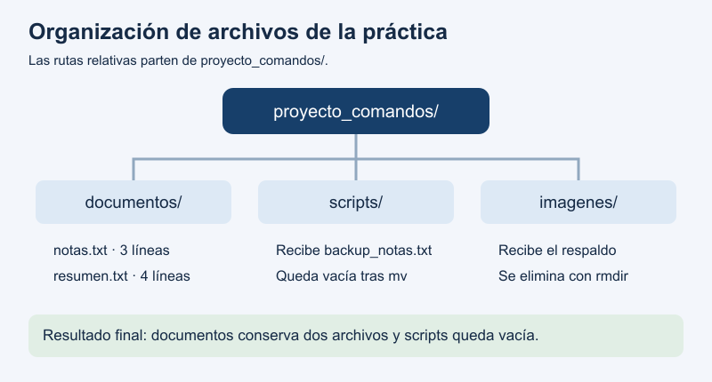
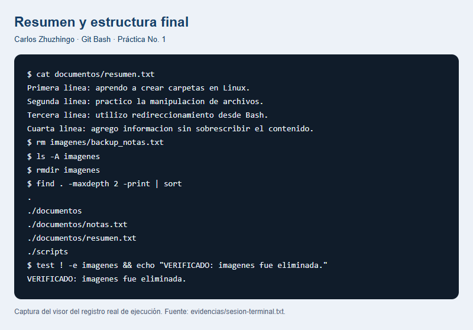

# Práctica No. 1: Comandos de Linux

**Nombre:** Carlos Zhuzhingo

**Fecha:** 12 de octubre de 2026

## 1. Título

Creación y manipulación de archivos en Linux.

## 2. Tiempo de duración

Aproximadamente 25 minutos.

## 3. Fundamentos

En esta práctica se usan comandos para crear carpetas y trabajar con archivos desde la terminal. La terminal es una ventana donde se escriben instrucciones para que el computador realice una acción. Para desarrollar la actividad se utilizó Git Bash en Windows, que permite practicar los comandos indicados en la tarea.

Las carpetas ayudan a mantener los archivos ordenados. En este caso, proyecto_comandos es la carpeta principal y dentro se crean documentos, imagenes y scripts. El comando mkdir sirve para crear estas carpetas. Con cd se entra en una carpeta para continuar trabajando dentro de ella. Antes de crear o mover un archivo, es importante comprobar en qué carpeta se está trabajando para evitar guardarlo en otro lugar.

Los archivos de texto permiten guardar información escrita. Con touch se puede crear un archivo vacío y con echo se pueden escribir líneas de texto. El comando cat permite leer lo que contiene el archivo y revisar si las líneas se guardaron correctamente. En notas.txt se escribieron tres líneas relacionadas con la práctica.

Para guardar texto se usan los símbolos > y >>. El primero escribe en el archivo, pero reemplaza lo que tenía antes. El segundo agrega texto al final y conserva las líneas anteriores. Esta diferencia es necesaria para crear el resumen y añadir una línea nueva sin perder las notas originales.

El comando cp sirve para copiar un archivo y conservar el original. También permite darle otro nombre a la copia. El comando mv se usa para mover un archivo de una carpeta a otra. Para eliminar un archivo se utiliza rm. Si se quiere eliminar una carpeta vacía, se utiliza rmdir. Por eso, primero se borra el respaldo y después la carpeta imagenes.

Finalmente, history permite consultar los comandos usados. El símbolo |, llamado tubería, pasa la salida de un comando a otro. Al escribir history | tee seguido del nombre del archivo, el historial se muestra en la terminal y también se guarda. Este archivo sirve como registro de los pasos realizados en la práctica.



*Figura 1. Organización de las carpetas y archivos de la práctica.*

## 4. Conocimientos previos

- Abrir Git Bash y escribir comandos.
- Reconocer archivos y carpetas.
- Subir archivos a un repositorio de GitHub.

## 5. Objetivos a alcanzar

- Crear las carpetas y archivos solicitados.
- Copiar, cambiar de nombre, mover y eliminar archivos.
- Guardar texto y añadir líneas sin borrar el contenido anterior.
- Guardar el historial de comandos mediante una tubería.

## 6. Equipo necesario

- Computador con Windows y Git Bash.
- Conexión a Internet y cuenta de GitHub.
- Teléfono o micrófono para grabar el audio.

## 7. Material de apoyo

- Indicaciones de la tarea autónoma de la semana 1.
- [Plantilla del informe](https://github.com/maguaman2/informe-tendencias/blob/main/informe.md).
- Manuales de Bash y de los comandos utilizados.

## 8. Procedimiento

### Paso 1. Crear la estructura de carpetas

Creé la carpeta proyecto_comandos. Dentro de ella creé documentos, imagenes y scripts.

```bash
mkdir proyecto_comandos
cd proyecto_comandos
mkdir documentos imagenes scripts
```

### Paso 2. Crear, copiar y mover el archivo

En documentos creé notas.txt y escribí tres líneas. Después lo copié a scripts con el nombre backup_notas.txt y moví la copia a imagenes.

```bash
touch documentos/notas.txt
echo "Primera linea: aprendo a crear carpetas en Linux." > documentos/notas.txt
echo "Segunda linea: practico la manipulacion de archivos." >> documentos/notas.txt
echo "Tercera linea: utilizo redireccionamiento desde Bash." >> documentos/notas.txt
cat documentos/notas.txt
cp documentos/notas.txt scripts/backup_notas.txt
mv scripts/backup_notas.txt imagenes/backup_notas.txt
```

### Paso 3. Crear el resumen y añadir una línea

Creé resumen.txt en documentos y guardé en él el contenido de notas.txt. Luego añadí una cuarta línea usando >> para conservar las anteriores.

```bash
touch documentos/resumen.txt
cat documentos/notas.txt > documentos/resumen.txt
echo "Cuarta linea: agrego informacion sin sobrescribir el contenido." >> documentos/resumen.txt
cat documentos/resumen.txt
```

### Paso 4. Eliminar el respaldo y la carpeta imagenes

Eliminé backup_notas.txt. Revisé que imagenes estuviera vacía y después eliminé la carpeta.

```bash
rm imagenes/backup_notas.txt
ls -A imagenes
rmdir imagenes
```

### Paso 5. Guardar el historial

Guardé el historial con mi nombre usando una tubería. Ejecuté el comando desde proyecto_comandos; ../ permite guardar el archivo fuera de esa carpeta, junto al informe.

```bash
history | tee ../tarea-s1-Carlos_Zhuzhingo.txt
```

El historial se encuentra en [tarea-s1-Carlos_Zhuzhingo.txt](tarea-s1-Carlos_Zhuzhingo.txt).

## 9. Resultados esperados

Al finalizar, notas.txt quedó con tres líneas y resumen.txt con cuatro. El resumen conserva las tres líneas originales y la línea que se añadió al final. El archivo backup_notas.txt y la carpeta imagenes fueron eliminados. La carpeta scripts quedó vacía.

La estructura final fue la siguiente:

```text
proyecto_comandos/
├── documentos/
│   ├── notas.txt
│   └── resumen.txt
└── scripts/ (vacía)
```



*Figura 2. Resultado final mostrado en el visor del registro de Git Bash.*

El informe y el historial están guardados en el repositorio. También se incluye el [audio de 60 segundos en MP3](tarea-s1-Carlos_Zhuzhingo.mp3), donde explico lo aprendido.

## 10. Bibliografía

- Free Software Foundation. (s. f.). *Bash reference manual*. GNU Project. https://www.gnu.org/software/bash/manual/bash.html
- Free Software Foundation. (s. f.). *GNU Coreutils manual*. GNU Project. https://www.gnu.org/software/coreutils/manual/coreutils.html
- maguaman2. (s. f.). *informe-tendencias* [Plantilla de informe]. GitHub. https://github.com/maguaman2/informe-tendencias
