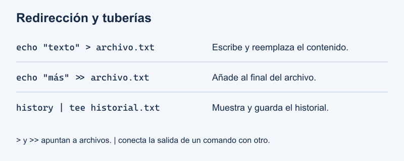
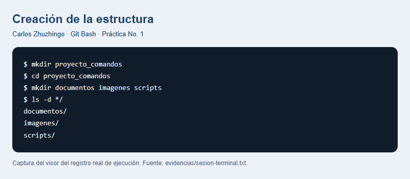
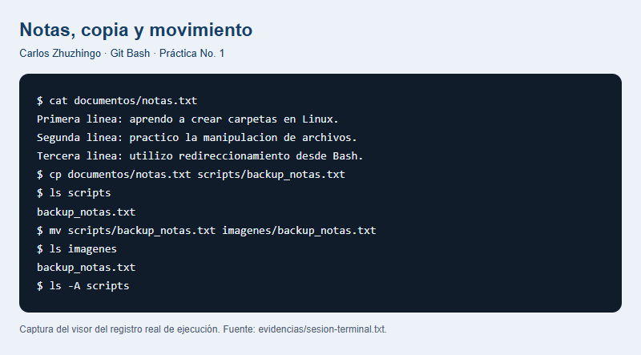
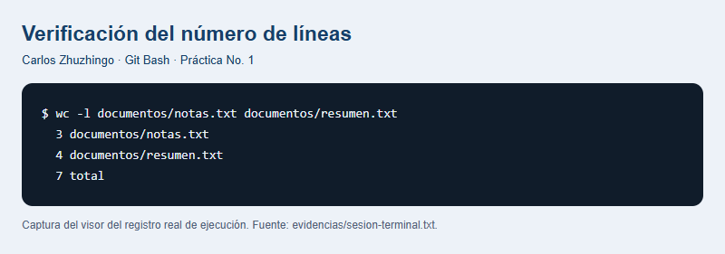

# Práctica No. 1: Comandos de Linux

**Estudiante:** Carlos Zhuzhingo  
**Actividad:** Tarea autónoma, semana 1  
**Fecha:** 12 de octubre de 2026  
**Entorno utilizado:** Git Bash en Windows — GNU bash, version 5.3.15(2)-release (x86_64-pc-cygwin)

## 1. Título

Creación de directorios, manipulación de archivos, redirección de salida y uso de tuberías con Bash.

## 2. Tiempo de duración

La ejecución automatizada de los comandos duró **0.013 minutos (0.78 segundos)**. Este valor corresponde únicamente a la sesión técnica registrada; no incluye lectura, elaboración del informe, publicación ni grabación del audio.

## 3. Fundamentos

La terminal es una interfaz de texto que permite comunicarse con el sistema mediante instrucciones. Bash es un intérprete de comandos: recibe una orden, interpreta sus argumentos y solicita su ejecución. En esta práctica se utilizó Git Bash en Windows, una de las alternativas permitidas en la consigna. Este entorno proporciona Bash y herramientas de estilo Unix para practicar comandos utilizados habitualmente en Linux. Las operaciones se realizaron dentro de un directorio de trabajo específico, lo que permitió mantener organizados los archivos de la actividad.

El sistema de archivos se organiza mediante directorios y archivos. Un directorio puede contener otros directorios, mientras que un archivo almacena información. Una ruta indica la ubicación de un elemento. Las rutas relativas parten del directorio actual; por ejemplo, documentos/notas.txt identifica un archivo dentro de la subcarpeta documentos. El comando pwd muestra la ubicación actual y cd permite cambiar de directorio. El comando mkdir crea carpetas, mientras que touch permite crear un archivo vacío cuando todavía no existe.

La manipulación de archivos incluye copiar, mover, renombrar y eliminar. El comando cp crea una copia y conserva el archivo original. Si el destino contiene otro nombre, la copia recibe ese nombre. En cambio, mv traslada el archivo o cambia su nombre, según la ruta de destino. En la práctica, notas.txt se conservó en documentos, su copia se llamó backup_notas.txt y después se trasladó desde scripts hasta imagenes. El comando rm elimina archivos. Para quitar una carpeta vacía se emplea rmdir, que falla si la carpeta contiene elementos; por ello se comprobó su contenido antes de eliminarla.

La salida estándar es el canal por el que un comando presenta normalmente sus resultados. El operador > dirige esa salida hacia un archivo, lo crea si no existe y reemplaza su contenido anterior si ya existe. El operador >> agrega la salida al final y conserva lo que estaba escrito. Por su parte, echo produce una línea de texto y cat muestra el contenido de uno o varios archivos. Así, cat documentos/notas.txt > documentos/resumen.txt permitió escribir las notas en el resumen, y echo con >> añadió una cuarta línea sin perder las tres primeras.

Una tubería, representada por |, conecta la salida estándar de un comando con la entrada estándar del siguiente. No equivale a la redirección hacia un archivo: conecta dos procesos. El comando history muestra las órdenes registradas por la sesión de Bash. Al ejecutar history | tee ../tarea-s1-Carlos_Zhuzhingo.txt, tee recibió ese historial, lo mostró en la terminal y simultáneamente lo guardó en el archivo solicitado. De esta manera se generó una evidencia real de los comandos ejecutados, útil para revisar el procedimiento y relacionarlo con los resultados obtenidos.


*Figura 1. Organización de las carpetas y efecto de las operaciones realizadas. Elaboración propia.*



*Figura 2. Diferencia entre sobrescribir, añadir contenido y conectar comandos. Elaboración propia.*

Se utilizó **imagenes**, sin tilde, de forma consistente, conforme al nombre indicado al crear las tres subcarpetas.

## 4. Conocimientos previos

- Abrir una terminal y reconocer el directorio de trabajo.
- Distinguir archivos, carpetas y rutas relativas.
- Escribir comandos respetando espacios, nombres y argumentos.
- Comprender que borrar un archivo cambia el contenido del sistema de archivos.
- Manejar un navegador y una cuenta de GitHub para consultar y entregar el repositorio.

## 5. Objetivos a alcanzar

- Crear la estructura proyecto_comandos con documentos, imagenes y scripts.
- Crear un archivo de texto con al menos tres líneas.
- Copiar, renombrar, mover y eliminar archivos mediante comandos.
- Diferenciar la redirección que sobrescribe de la que añade información.
- Eliminar una carpeta únicamente después de comprobar que está vacía.
- Guardar el historial de Bash mediante una tubería en el archivo solicitado.
- Documentar el procedimiento y sus resultados en Markdown.

## 6. Equipo necesario

- Computador con Windows y Git Bash instalado.
- Bash y utilidades mkdir, touch, echo, cat, cp, mv, rm, rmdir y tee.
- Conexión a Internet y cuenta de GitHub.
- Micrófono o teléfono para la grabación personal del audio de 60 segundos.

## 7. Material de apoyo

- Consigna de la tarea autónoma de la semana 1.
- [Plantilla de informe de maguaman2](https://github.com/maguaman2/informe-tendencias/blob/main/informe.md).
- Manual de referencia de GNU Bash y manual de GNU Coreutils.
- [Historial de la práctica](tarea-s1-Carlos_Zhuzhingo.txt).
- [Registro completo de ejecución](evidencias/sesion-terminal.txt).

## 8. Procedimiento

Los comandos se ejecutaron realmente en una sesión interactiva aislada de Git Bash. Se conservó su historial sin utilizar el historial personal de otras sesiones. Las figuras 3 a 6 son capturas de un visor del registro real de salida; el archivo de texto completo permite contrastarlas. La ejecución se realizó mediante asistencia automatizada.

### Paso 1. Comprobar la ubicación y crear las carpetas

Desde el directorio de trabajo se ejecutó:

```bash
pwd
bash --version | head -n 1
mkdir proyecto_comandos
cd proyecto_comandos
mkdir documentos imagenes scripts
ls -d */
```

Se verificó la existencia de las tres subcarpetas.



*Figura 3. Captura del registro de creación de proyecto_comandos y sus subcarpetas.*

### Paso 2. Crear notas.txt y escribir tres líneas

```bash
touch documentos/notas.txt
echo "Primera linea: aprendo a crear carpetas en Linux." > documentos/notas.txt
echo "Segunda linea: practico la manipulacion de archivos." >> documentos/notas.txt
echo "Tercera linea: utilizo redireccionamiento desde Bash." >> documentos/notas.txt
cat documentos/notas.txt
```

La primera escritura utilizó >. Las dos siguientes utilizaron >> para conservar las líneas anteriores. El archivo resultante contiene tres líneas.

### Paso 3. Copiar, renombrar y mover el respaldo

```bash
cp documentos/notas.txt scripts/backup_notas.txt
ls scripts
mv scripts/backup_notas.txt imagenes/backup_notas.txt
ls imagenes
ls -A scripts
```

cp copió el contenido y asignó el nombre backup_notas.txt. mv trasladó esa copia a imagenes. notas.txt permaneció en documentos y scripts quedó vacía.



*Figura 4. Captura del registro de lectura, copia y movimiento del archivo.*

### Paso 4. Crear el resumen y añadir una línea

```bash
touch documentos/resumen.txt
cat documentos/notas.txt > documentos/resumen.txt
echo "Cuarta linea: agrego informacion sin sobrescribir el contenido." >> documentos/resumen.txt
cat documentos/resumen.txt
```

El resumen conservó las tres líneas de notas.txt e incorporó una cuarta línea al final.

### Paso 5. Eliminar el respaldo y la carpeta vacía

```bash
rm imagenes/backup_notas.txt
ls -A imagenes
rmdir imagenes
find . -maxdepth 2 -print | sort
test ! -e imagenes && echo "VERIFICADO: imagenes fue eliminada."
```

ls -A imagenes no mostró elementos después de borrar el respaldo. Entonces rmdir pudo eliminar la carpeta vacía.


*Figura 5. Captura del registro del resumen y de la estructura final de la práctica.*

### Paso 6. Verificar el contenido conservado

```bash
test ! -e scripts/backup_notas.txt && echo "VERIFICADO: no queda la copia de respaldo."
wc -l documentos/notas.txt documentos/resumen.txt
head -n 3 documentos/resumen.txt | cmp - documentos/notas.txt && echo "VERIFICADO: resumen conserva las tres lineas originales."
```

wc -l devolvió 3 líneas para notas.txt y 4 para resumen.txt. La comparación con cmp confirmó que las primeras tres líneas del resumen coinciden con el archivo original.



*Figura 6. Captura del registro del conteo de líneas de los archivos finales.*

### Paso 7. Guardar el historial con una tubería

Desde proyecto_comandos se ejecutó:

```bash
history | tee ../tarea-s1-Carlos_Zhuzhingo.txt
```

El operador | conectó history con tee. El prefijo ../ guardó el archivo en la raíz del repositorio, junto al informe. El historial contiene 29 entradas, incluida la orden que lo exportó.

### Paso 8. Preparar la entrega

El informe se guardó como informe.md y el historial como tarea-s1-Carlos_Zhuzhingo.txt. Las evidencias y los archivos finales se incluyeron en el mismo repositorio. Git no conserva directorios vacíos; por ello scripts existe en la práctica local y también se conserva en el ZIP de entrega, aunque no aparece como carpeta independiente en GitHub.

La grabación personal debe guardarse como tarea-s1-Carlos_Zhuzhingo.mp3 y durar 60 segundos. Se incluye un [guion de apoyo](guion-audio-Carlos_Zhuzhingo.md) para que el estudiante lo adapte y lo grabe con su voz. El audio sigue pendiente de esa grabación.

## 9. Resultados esperados

La ejecución produjo los resultados previstos en los apartados de archivos y carpetas:

| Elemento comprobado | Resultado obtenido |
| --- | --- |
| proyecto_comandos/documentos/notas.txt | Existe y contiene tres líneas. |
| proyecto_comandos/documentos/resumen.txt | Existe y contiene cuatro líneas. |
| Contenido inicial del resumen | Coincide con las tres líneas de notas.txt. |
| proyecto_comandos/scripts | Existe y está vacía en la práctica local. |
| backup_notas.txt | Fue copiado, movido y después eliminado. |
| proyecto_comandos/imagenes | Fue eliminada después de quedar vacía. |
| tarea-s1-Carlos_Zhuzhingo.txt | Contiene la salida real de history, guardada mediante una tubería. |

La estructura final es:

```text
proyecto_comandos/
├── documentos/
│   ├── notas.txt
│   └── resumen.txt
└── scripts/             (vacía)
```

Las capturas de los resultados se presentan en las figuras 5 y 6. La práctica permitió diferenciar copia y movimiento, utilizar > y >>, y comprobar por qué rmdir requiere una carpeta vacía. El historial permite reconstruir la secuencia de trabajo.

## 10. Bibliografía

- Free Software Foundation. (s. f.). *Bash reference manual*. GNU Project. https://www.gnu.org/software/bash/manual/bash.html
- Free Software Foundation. (s. f.). *GNU Coreutils manual*. GNU Project. https://www.gnu.org/software/coreutils/manual/coreutils.html
- maguaman2. (s. f.). *informe-tendencias: informe.md* [Plantilla de informe]. GitHub. https://github.com/maguaman2/informe-tendencias/blob/main/informe.md
